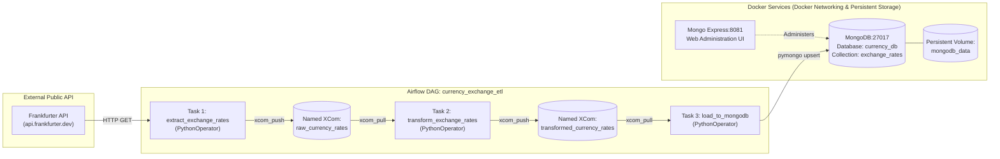

# Building Airflow ETL Pipeline with Astro CLI, MongoDB & Mongo Express

## Overview
This repository contains an end-to-end automated ETL (Extract, Transform, Load) pipeline orchestrating daily currency exchange rate updates into MongoDB using **Apache Airflow** and **Astro CLI** (Astronomer CLI). 

The pipeline extracts currency exchange rates from the free, public **Frankfurter API**, validates and transforms records into a strict standardized JSON schema, and loads the data into **MongoDB**. **Mongo Express** is deployed as an administrative web interface to visualize and manage database records.

---

## Architecture Diagram



---

## Components & Technical Specifications

### 1. Data Source (Frankfurter API)
- **Base Endpoint**: `https://api.frankfurter.dev/v2/rates`
- **Request Parameters**: `base=EUR&quotes=USD,GBP,JPY`
- **Source Type**: Free, public currency exchange rate API without API key requirement.

### 2. Airflow Pipeline (`dags/currency_exchange_etl.py`)
Comprises exactly three (3) tasks communicating strictly via **Airflow Named XCom**:

| Task ID | Task Description | Named XCom Key | Direction |
| :--- | :--- | :--- | :--- |
| `extract_exchange_rates` | Fetches daily quotes from Frankfurter API | `raw_currency_rates` | **Pushes** raw JSON array |
| `transform_exchange_rates` | Shapes payload into schema-compliant records | `raw_currency_rates`<br>`transformed_currency_rates` | **Pulls** raw rates<br>**Pushes** transformed records |
| `load_to_mongodb` | Connects to MongoDB and performs idempotent upserts | `transformed_currency_rates` | **Pulls** transformed records |

#### Transformed Data Schema
Every transformed record strictly satisfies the assignment format:
```json
{
  "base_currency": "EUR",
  "target_currency": "USD",
  "exchange_rate": 1.1122,
  "rate_date": "2026-11-12",
  "source": "Frankfurter API",
  "retrieved_at": "2026-11-12T17:15:00"
}
```

### 3. Docker Networking & Persistent Storage (`docker-compose.override.yml`)
- **Docker Networking**: MongoDB and Mongo Express share the internal Docker bridge network with Airflow containers, enabling internal hostname resolution (`mongodb:27017`).
- **Persistent Storage**: MongoDB uses a named volume (`mongodb_data:/data/db`) to guarantee data persists across container teardowns and restarts.
- **Port Mappings**:
  - Airflow Webserver: `http://localhost:8080` (admin:admin)
  - MongoDB: `localhost:27017`
  - Mongo Express UI: `http://localhost:8081` (admin:password123)

---

## Project Structure
```
airflow-ETL/
├── .astro/
├── dags/
│   ├── .airflowignore
│   └── currency_exchange_etl.py       # 3-task Airflow DAG with Named XCom
├── tests/
│   ├── dags/
│   │   └── test_dag_example.py        # Astro default DAG tests
│   └── test_currency_exchange_etl.py  # Unit tests for schema & XCom logic
├── docker-compose.override.yml        # MongoDB + Mongo Express service definition
├── requirements.txt                   # Project dependencies (pymongo, requests, pytest)
├── Dockerfile                         # Astro Runtime image configuration
├── .gitignore                         # Git exclusion rules
└── README.md                          # Project documentation
```

---

## Quick Start Guide

### Prerequisites
1. **Docker Desktop** installed and running.
2. **Astro CLI** (installed via winget or binary download).

### 1. Clone & Navigate to Repository
```powershell
git clone <your-repo-url>
cd airflow-ETL
```

### 2. Start the Stack with Astro CLI
Launch Airflow along with MongoDB and Mongo Express:
```powershell
astro dev start
```
*Note: The first run downloads the Astro runtime image, MongoDB, and Mongo Express images.*

### 3. Access the Web Interfaces
- **Apache Airflow UI**: [http://localhost:8080](http://localhost:8080)
  - Username: `admin`
  - Password: `admin`
- **Mongo Express Web UI**: [http://localhost:8081](http://localhost:8081)
  - Username: `admin`
  - Password: `password123`

### 4. Trigger & Verify the DAG
1. Log into the Airflow UI.
2. Locate the DAG named **`currency_exchange_etl`**.
3. Toggle the DAG **ON** and click the **Trigger DAG** (Play) button.
4. Watch the 3 tasks execute sequentially:
   - `extract_exchange_rates` (Dark Green / Success)
   - `transform_exchange_rates` (Dark Green / Success)
   - `load_to_mongodb` (Dark Green / Success)
5. Verify Named XComs in Airflow:
   - Go to **Admin** -> **XComs** in the top navigation bar.
   - Filter by `dag_id: currency_exchange_etl`.
   - Confirm keys `raw_currency_rates` and `transformed_currency_rates`.
6. Verify Data in Mongo Express:
   - Open [http://localhost:8081](http://localhost:8081).
   - Click on database **`currency_db`**.
   - Click on collection **`exchange_rates`**.
   - Review the inserted documents for EUR to USD, GBP, and JPY.

### 5. Running Automated Tests
Run unit tests locally:
```powershell
python -m pytest
```
Or run inside the Astro runtime container:
```powershell
astro dev pytest
```

### 6. Stop the Stack
```powershell
astro dev stop
```

---

## Submission Checklist for Assignment Report
To prepare your submission report:
- [ ] Screenshot of **DAG Graph / Grid View** in Airflow showing all 3 tasks with status `Success`.
- [ ] Screenshot of **Airflow XCom page** (`Admin` -> `XComs`) displaying `raw_currency_rates` and `transformed_currency_rates`.
- [ ] Screenshot of **Mongo Express UI** showing database `currency_db`, collection `exchange_rates`, and the inserted documents.
- [ ] Code repository link pushed to GitHub / DagsHub.
